# RPG de Console: A Torre do Dragão

Trabalho Prático de **Paradigmas de Programação**, curso de **Ciência da Computação** do Centro Universitário Dom Helder (3º período).

RPG em modo console, escrito em **Java**. O jogador escolhe uma classe de herói e enfrenta três batalhas por turnos (Goblin, Esqueleto e o chefão Dragão Ancestral), usando ataques, habilidades especiais e itens. O objetivo do trabalho é aplicar a **Programação Orientada a Objetos** e os **5 princípios SOLID**.

---

## Sumário
1. [Funcionalidades](#funcionalidades)
2. [Como compilar e executar](#como-compilar-e-executar)
3. [Como jogar](#como-jogar)
4. [Estrutura do projeto](#estrutura-do-projeto)
5. [Diagrama de classes](#diagrama-de-classes)
6. [Princípios SOLID no código](#princípios-solid-no-código)
7. [Conceitos de POO aplicados](#conceitos-de-poo-aplicados)
8. [Capturas de tela](#capturas-de-tela)
9. [Tecnologias](#tecnologias)

---

## Funcionalidades

| Requisito do enunciado | Como foi atendido |
|---|---|
| **Personagens** | 3 classes jogáveis com Vida, Ataque e Defesa próprios e uma habilidade especial cada: **Guerreiro** (Golpe Poderoso: dano dobrado), **Mago** (Bola de Fogo: dano dobrado que ignora a defesa) e **Arqueiro** (Disparo Duplo: dois ataques na mesma rodada). As habilidades têm recarga de 3 rodadas. |
| **Inimigos e combate** | Combate por turnos contra 2 inimigos comuns (**Goblin** e **Esqueleto**) e 1 chefão (**Dragão Ancestral**), que usa o **Sopro de Fogo** e avisa uma rodada antes. |
| **Itens e inventário** | **Poções de Cura**, **Armas** (+ataque) e **Armaduras** (+defesa). Os itens são usados durante a batalha ou no acampamento entre batalhas. Os inimigos deixam itens de recompensa. Ao trocar de equipamento, o antigo volta para o inventário. |
| **Interface de console** | Menus numerados, barra de vida em texto e validação de entrada: letras ou números fora do intervalo são recusados e a pergunta se repete. |

| Personagem | Vida | Ataque | Defesa | Habilidade |
|---|---|---|---|---|
| Guerreiro | 120 | 14 | 8 | Golpe Poderoso: ataque × 2 |
| Mago | 90 | 19 | 4 | Bola de Fogo: ataque × 2, ignora a defesa |
| Arqueiro | 100 | 16 | 5 | Disparo Duplo: dois ataques |
| Goblin | 45 | 12 | 3 | — (deixa uma Poção de Cura) |
| Esqueleto | 60 | 14 | 5 | — (deixa a Espada de Aço, +6 ATQ) |
| **Dragão Ancestral** | 150 | 17 | 8 | Sopro de Fogo: ataque × 1,5, ignora metade da defesa |

---

## Como compilar e executar

**Requisito:** JDK 17 ou superior (testado com OpenJDK 21). Verifique com `java -version`.

### Jeito mais fácil
1. Baixe o projeto (**Code → Download ZIP** nesta página) e extraia o arquivo.
2. **Windows:** dê dois cliques em **`jogar.bat`**. **Linux/macOS:** rode `./jogar.sh` no terminal.

O script compila o jogo na primeira vez e abre o console pronto para jogar.

### Pelo terminal

Os mesmos comandos funcionam no **Windows** (cmd ou PowerShell), no **Linux** e no **macOS**:

```bash
git clone https://github.com/FernandoJose-ESDHC/rpg-console.git
cd rpg-console
javac -encoding UTF-8 -d out -sourcepath src src/Main.java
java -cp out Main
```

- `-sourcepath src` faz o `javac` encontrar sozinho todas as classes usadas a partir do `Main` (os 27 arquivos).
- `-d out` coloca os `.class` compilados na pasta `out/`.
- `-encoding UTF-8` garante que os acentos do código sejam lidos corretamente.

> **Acentos aparecendo errado no Windows?** Rode `chcp 65001` antes do jogo, ou execute com `java -Dstdout.encoding=UTF-8 -cp out Main`.

> **Partida reproduzível (para testes):** informe uma semente, por exemplo `java -cp out Main 42`. Com a mesma semente e as mesmas escolhas, a partida sai sempre igual.

### Testes das regras (opcional)
Depois de compilar o jogo, rode as 9 verificações automáticas (vida, cura, equipamentos, recarga e Sopro de Fogo):

```bash
javac -encoding UTF-8 -cp out -d out testes/TesteRegras.java
java -cp out TesteRegras
```

---

## Como jogar
1. Digite o nome do herói e escolha a classe (1, 2 ou 3).
2. Em cada rodada, escolha: **1) Atacar**, **2) Habilidade especial** (se estiver `[PRONTA]`) ou **3) Usar item**.
3. Depois do seu turno, o inimigo age.
4. Entre as batalhas, no **acampamento**, você pode equipar itens e ver o status do herói.
5. Vença as 3 batalhas para derrotar o Dragão. Dica: equipe a armadura logo no início e guarde as poções para o chefão.

---

## Estrutura do projeto

```
rpg-console/
├── src/
│   ├── Main.java                 # ponto de entrada: monta e injeta as dependências
│   ├── personagens/
│   │   ├── Combatente.java       # interface: o que todo combatente faz
│   │   ├── Curavel.java          # interface: quem pode ser curado
│   │   ├── UsaHabilidade.java    # interface: quem tem habilidade especial
│   │   ├── Personagem.java       # classe abstrata base (atributos encapsulados)
│   │   ├── Heroi.java            # classe abstrata dos heróis (inventário, equipamentos)
│   │   ├── Guerreiro.java  Mago.java  Arqueiro.java
│   │   ├── Inimigo.java          # classe abstrata dos inimigos
│   │   └── Goblin.java  Esqueleto.java  ChefeDragao.java
│   ├── itens/
│   │   ├── Item.java             # interface de todo item
│   │   ├── PocaoDeCura.java
│   │   ├── Equipamento.java      # classe abstrata (arma/armadura)
│   │   ├── Arma.java  Armadura.java
│   │   └── Inventario.java
│   ├── combate/
│   │   ├── CalculadoraDeDano.java    # interface da regra de dano
│   │   ├── CalculadoraPadrao.java    # implementação: ataque - defesa/2, ±20%
│   │   └── Batalha.java              # controla os turnos
│   ├── ui/
│   │   ├── EntradaSaida.java     # interface de entrada/saída
│   │   ├── Console.java          # implementação com System.out e Scanner
│   │   ├── MenuDeInventario.java
│   │   └── Formatador.java       # barra de vida e linha de status
│   └── jogo/
│       └── Jogo.java             # fluxo da partida (criação, batalhas, acampamento)
├── testes/
│   └── TesteRegras.java          # verificações automáticas das regras
├── docs/
│   ├── diagrama-classes.png / .svg / .dot
│   └── prints/                   # capturas de tela da execução
├── jogar.bat / jogar.sh        # abrem o jogo com dois cliques / um comando
├── apresentacao.pptx
└── documentacao.pdf
```

**Fluxo:** `Main` cria `Console`, `CalculadoraPadrao` e a lista de inimigos → `Jogo.iniciar()` cria o herói → para cada inimigo, uma `Batalha.executar()` → acampamento → vitória ou derrota.

---

## Diagrama de classes

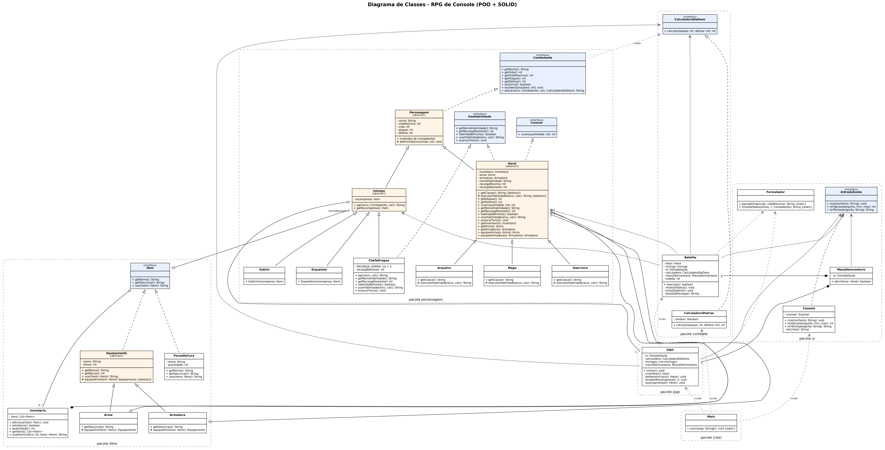

Versão vetorial (com zoom sem perder qualidade): [`docs/diagrama-classes.svg`](docs/diagrama-classes.svg). Legenda: triângulo vazio com linha contínua = **herança**; triângulo vazio com linha tracejada = **implementa interface**; losango cheio = **composição**; losango vazio = **agregação**; seta tracejada = **dependência** («cria»/«usa»).

---

## Princípios SOLID no código

### S: Single Responsibility (Responsabilidade Única)
Cada classe tem **um único motivo para mudar**:

| Classe | Única responsabilidade |
|---|---|
| `Batalha` | controlar a ordem dos turnos |
| `CalculadoraPadrao` | calcular o dano |
| `Inventario` | guardar e usar itens (não imprime nada) |
| `MenuDeInventario` | mostrar o inventário e perguntar qual item usar |
| `Console` | ler e escrever no terminal. É a **única** classe que usa `System.out` e `Scanner` |
| `Jogo` | fluxo da partida (criar herói, sequência de batalhas, acampamento) |

Se a fórmula de dano mudar, só `CalculadoraPadrao` muda. Se a interface mudar de console para janela, só `Console` muda.

### O: Open/Closed (Aberto/Fechado)
O código está **aberto para extensão e fechado para modificação**:
- **Novo inimigo:** basta criar `class Orc extends Inimigo` e adicioná-lo à lista no `Main`. A `Batalha` não muda, porque só chama `inimigo.agir(...)`.
- **Novo item:** basta criar uma classe que implemente `Item`. `Inventario` e `MenuDeInventario` não mudam.
- **Nova regra de dano** (ex.: modo difícil): basta criar outra classe que implemente `CalculadoraDeDano`.

```java
// Batalha.java: funciona com QUALQUER inimigo, atual ou futuro
if (inimigo.estaVivo()) {
    io.mostrar(inimigo.agir(heroi, calculadora));
}
```

### L: Liskov Substitution (Substituição de Liskov)
Qualquer subclasse pode ser usada no lugar da classe-mãe sem quebrar o programa:
- A `Batalha` recebe um `Heroi` e um `Inimigo`. Funciona igual com `Guerreiro`, `Mago` ou `Arqueiro` e com `Goblin`, `Esqueleto` ou `ChefeDragao`.
- O `ChefeDragao` **sobrescreve** `agir()` (às vezes usa o Sopro de Fogo), mas respeita o contrato: recebe um alvo, causa dano e devolve um texto.
- O `Heroi` sobrescreve `getAtaque()`/`getDefesa()` para somar os bônus dos equipamentos, mas continua devolvendo um número válido, como espera quem chama.

### I: Interface Segregation (Segregação de Interfaces)
Em vez de uma interface "gigante", há interfaces **pequenas e específicas**:

| Interface | Quem implementa | Por quê |
|---|---|---|
| `Combatente` | todos (via `Personagem`) | todos lutam |
| `Curavel` | só `Heroi` | inimigos não usam poções |
| `UsaHabilidade` | `Heroi` e `ChefeDragao` | Goblin e Esqueleto não têm habilidade |

Assim, `Goblin` não é obrigado a implementar `curar()` ou `usarHabilidade()` vazios.

### D: Dependency Inversion (Inversão de Dependência)
As classes de alto nível dependem de **abstrações (interfaces)**, não de classes concretas:
- `Batalha` e `Jogo` dependem de `EntradaSaida` e `CalculadoraDeDano`, **recebidas pelo construtor**.
- Só o `Main` conhece as classes concretas (`Console`, `CalculadoraPadrao`) e as **injeta**:

```java
// Main.java
EntradaSaida io = new Console();
CalculadoraDeDano calculadora = new CalculadoraPadrao(random);
Jogo jogo = new Jogo(io, calculadora, inimigos);
```

Graças a isso, o jogo pode ser testado com uma entrada simulada no lugar do teclado sem alterar nenhuma linha de `Jogo` ou `Batalha`.

---

## Conceitos de POO aplicados

| Conceito | Onde |
|---|---|
| **Abstração** | Classes abstratas `Personagem`, `Heroi`, `Inimigo`, `Equipamento` e interfaces `Combatente`, `Item`, `CalculadoraDeDano`, `EntradaSaida` |
| **Encapsulamento** | Atributos `private`; a vida só muda por `receberDano()`/`definirVida()`, que mantêm o valor entre 0 e o máximo; `Inventario.getItens()` devolve uma lista somente leitura |
| **Herança** | `Guerreiro`/`Mago`/`Arqueiro` → `Heroi` → `Personagem`; `Goblin`/`Esqueleto`/`ChefeDragao` → `Inimigo` → `Personagem`; `Arma`/`Armadura` → `Equipamento` |
| **Polimorfismo** | `executarHabilidade()` diferente em cada herói; `agir()` sobrescrito no `ChefeDragao`; `usar()` diferente em cada `Item` |
| **Composição** | `Heroi` **tem um** `Inventario` e **tem** `Arma`/`Armadura` |

---

## Capturas de tela

As imagens são trechos reais da saída do jogo, gravados em partidas executadas no terminal.

**Início, escolha de classe e validação de entrada**
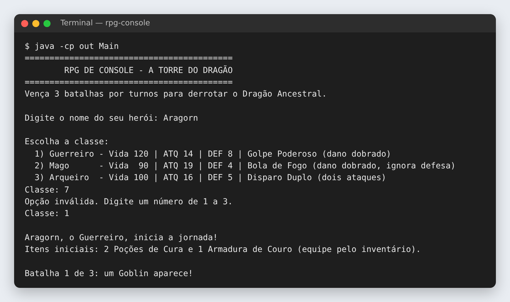

**Batalha por turnos e uso do inventário**
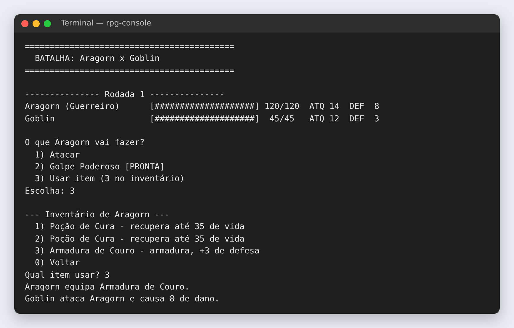

**Habilidade especial e recarga**
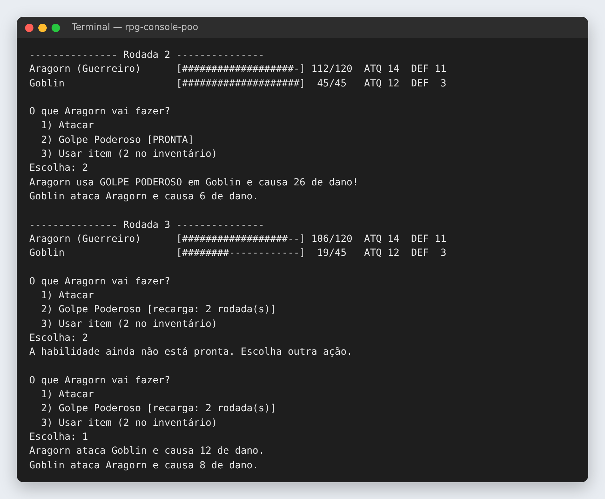

**Habilidades do Mago e do Arqueiro**
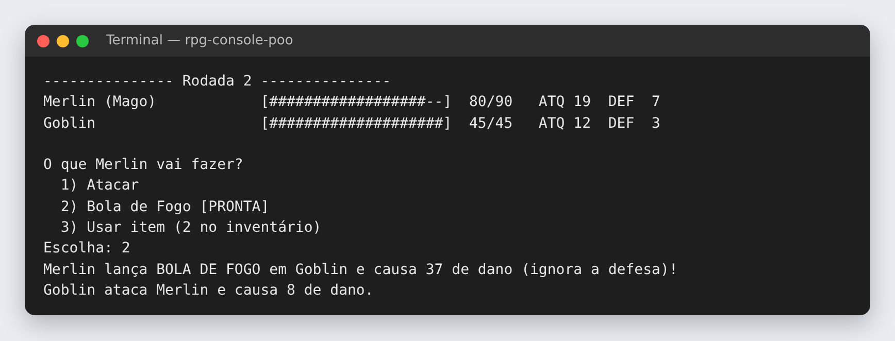
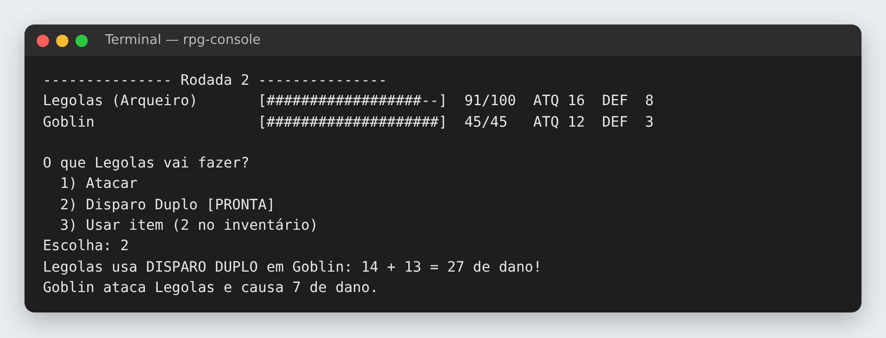

**Recompensa e acampamento**
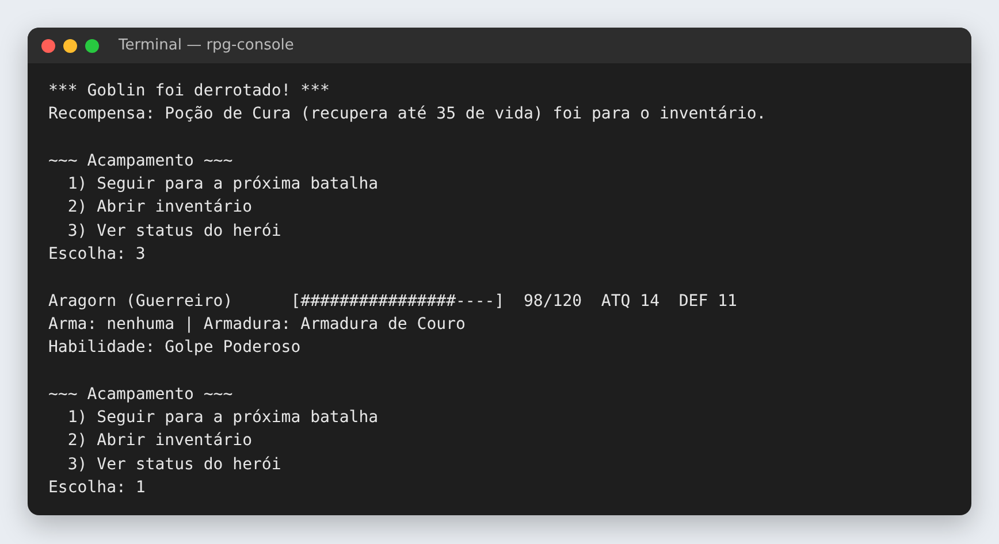

**Equipando a arma recebida**
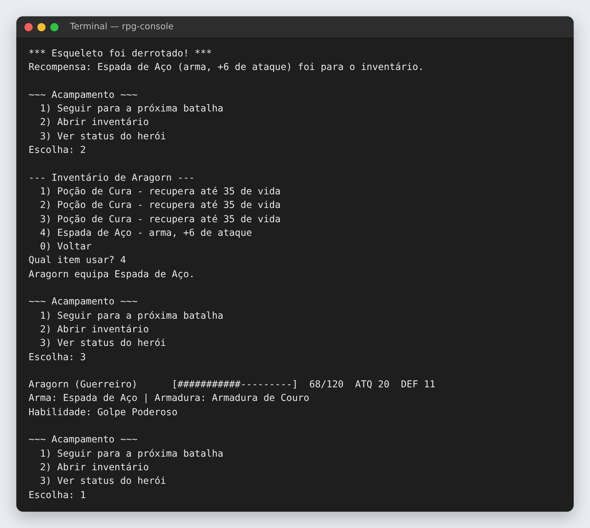

**Chefão: Sopro de Fogo**
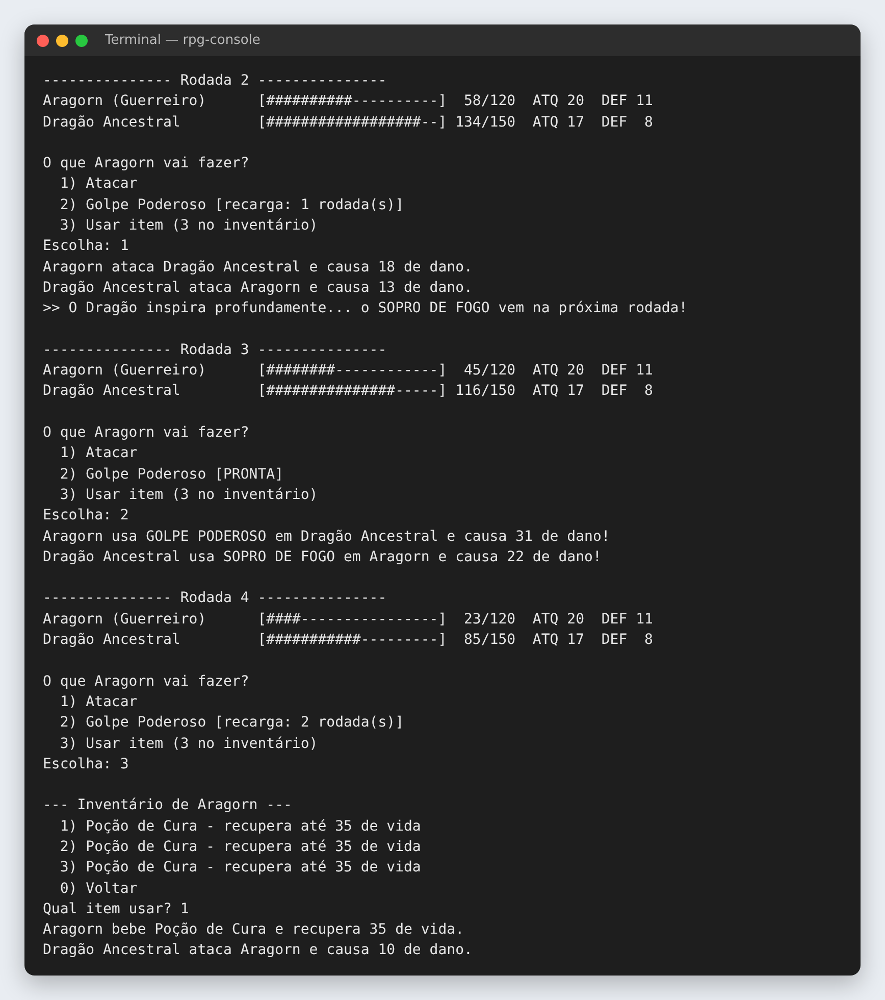

**Vitória e derrota**
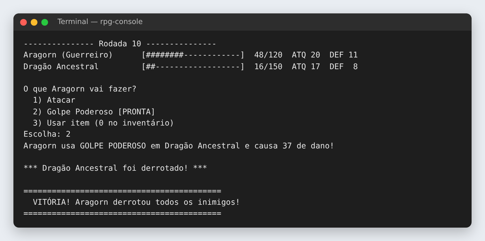
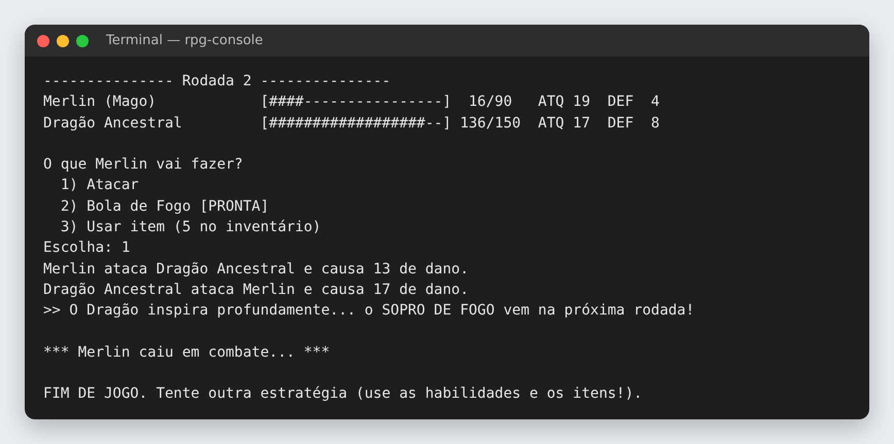

---

## Tecnologias
- **Java 17+**: linguagem com suporte completo a classes, interfaces e classes abstratas, ideal para demonstrar POO e SOLID.
- **Somente a biblioteca padrão** (`java.util.Scanner`, `ArrayList`, `Random`): sem frameworks, compila apenas com o `javac`.
- **Graphviz**: geração do diagrama de classes.

---

**Disciplina:** Paradigmas de Programação · **Curso:** Ciência da Computação · Centro Universitário Dom Helder
**Autor:** [FernandoJose-ESDHC](https://github.com/FernandoJose-ESDHC)
